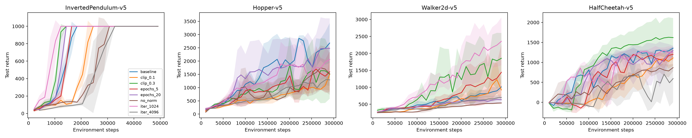

# PPO on MuJoCo: Hyperparameter Study

Proximal Policy Optimization (PPO) trained on 4 MuJoCo tasks from Gymnasium, with 8 experiments that each change one hyperparameter from a standard baseline.


## Project structure

| Path | What it is |
|---|---|
| `PPO.ipynb` | Main notebook: PPO implementation, training loop, experiments, results and discussion |
| `common_rl.py` | Setup helper file: settings, seeding, env creation, test evaluation, TensorBoard logger, results table |
| `requirements.txt` | Python dependencies |
| `runs/` | All results: TensorBoard logs, trained models, summaries, plots |

Each run is saved in `runs/{env}/PPO/{experiment}/seed{n}/`:

- `events.out.tfevents.*`: TensorBoard log
- `model.pt`: trained network and observation normalization stats
- `summary.json`: test evaluations and final score
- `ppo_diagnostics.json`: average KL, clip fraction and max ratio

## Setup

Python 3.12. A GPU is not needed: training runs on the CPU.

```bash
conda create -n ann python=3.12 -y
conda activate ann
pip install torch --index-url https://download.pytorch.org/whl/cu128
pip install -r requirements.txt
```

## How to run

Open `PPO.ipynb` and run the cells in order:

1. **Setup and hyperparameters**: loads the shared settings and defines the baseline and the experiments.
2. **Quick test**: a short run on Hopper to check that everything works and estimate the total time.
3. **Run all experiments**: trains all 96 runs. Finished runs (those with a `summary.json`) are skipped, so you can stop and resume.
4. **Results**: TensorBoard, the results table, PPO diagnostics and test-return curves.
5. **Watch the agent**: `watch()` plays a trained model in a MuJoCo window, or saves an MP4 with `record=True`.

To view the logs outside the notebook:

```bash
tensorboard --logdir runs
```

## Experimental setup

| Setting | Value |
|---|---|
| Environments | InvertedPendulum-v5 (50k steps), Hopper-v5, Walker2d-v5, HalfCheetah-v5 (300k steps each) |
| Seeds | 0, 1, 2 |
| Discount γ | 0.99 |
| Test | 10 deterministic episodes on a separate env, every 10k steps (2k for InvertedPendulum) |
| Final score | Mean of the last 3 tests, reported as mean ± std over the 3 seeds |
| Network | Separate actor and critic MLPs, 2 × 64 tanh units |

**Baseline** (Engstrom et al. / Ilyas et al., ICLR 2020): learning rate 3e-4 (linear decay), 2048 steps per iteration, minibatch 64, 10 epochs, clip ε = 0.2, GAE λ = 0.95, value coef 0.5, entropy coef 0, grad norm 0.5, observation and reward normalization on.

| Experiment | Change from baseline |
|---|---|
| `baseline` | none |
| `clip_0.1` / `clip_0.3` | clip range ε |
| `epochs_5` / `epochs_20` | update epochs per batch |
| `no_norm` | observation and reward normalization off |
| `iter_1024` / `iter_4096` | env steps per iteration |

8 experiments × 4 environments × 3 seeds = **96 runs**.

## Results

Baseline final scores (mean ± std over 3 seeds):

| Environment | Score |
|---|---|
| InvertedPendulum | 1000 ± 0 (solved) |
| Hopper | 2532 ± 481 |
| Walker2d | 924 ± 99 |
| HalfCheetah | 1303 ± 31 |



**Main findings:**

- **Best overall:** `iter_1024`, `baseline` and `clip_0.3`. With only 300k steps, settings that update more often or take bigger steps use the limited data better, but vary more between seeds.
- **Worst:** `iter_4096` (too few updates), `no_norm` (the critic cannot fit unscaled returns) and `clip_0.1` (steps too small to learn in time).
- **No single setting won everywhere:** baseline was best on Hopper, `iter_1024` on Walker2d and `clip_0.3` on HalfCheetah.
- **The trust region is not strictly enforced:** the probability ratio reached 1.8–7.8 against clip limits of 1.1–1.3.

See section 9 of the notebook for the full discussion, per-experiment results and limitations.

## Author

Moheeb Abusamra
